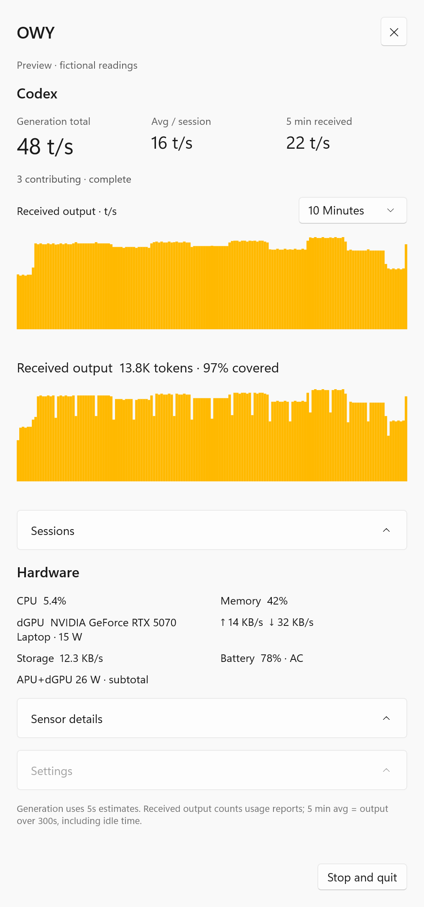
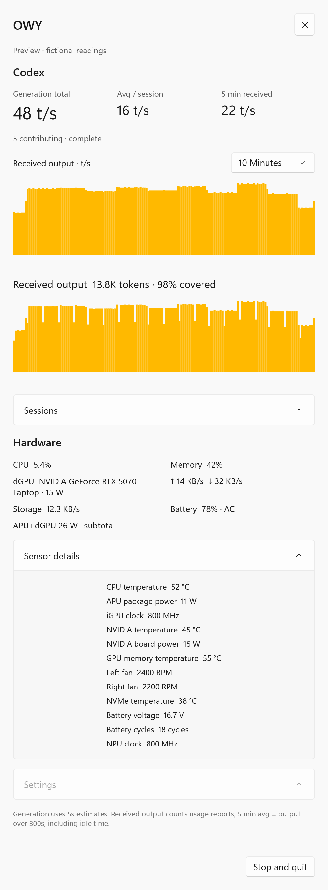
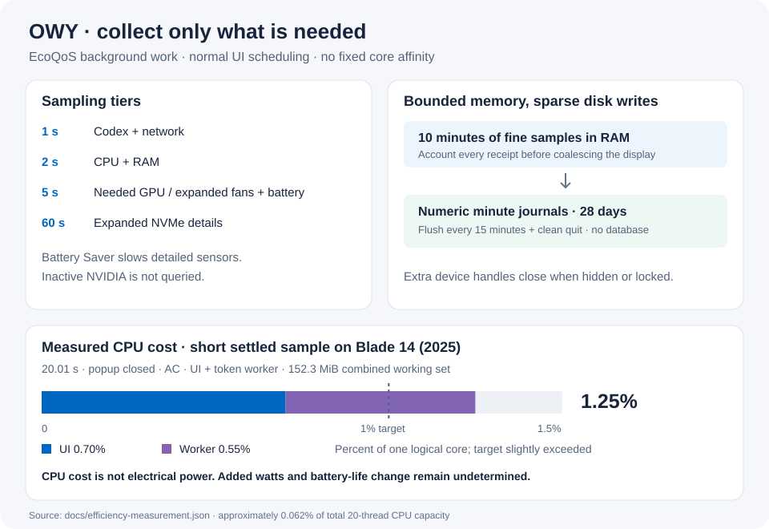

# OWY — Owl's Watching You


A native Windows 11 taskbar monitor for hardware readings and **local Codex
output**. Two compact rows sit beside the system tray: upload/download on the
left, Codex t/s and available power on the right. Click to open the WinUI popup.

**Tested on Razer Blade 14 (2025), RZ09-0530**, with Ryzen AI 9 365, Radeon 880M
and NVIDIA GeForce RTX 5070 Laptop GPU. Other laptops with Ryzen CPUs and NVIDIA
GPUs may work through the same Windows/driver interfaces; they are not yet
validated. Unsupported readings stay unavailable.

## Interface

These are native WinUI light-theme captures made with `--demo`. Every reading is fictional;
no real session, account or sensor data is shown. The second image expands
**Sensor details** inside the same popup.

| Compact popup | Sensor details expanded |
| --- | --- |
|  |  |

- Taskbar light/dark appearance, popup theme and high-contrast preferences are
  handled separately. Placement adapts to Explorer restart and scaling; unsafe
  placement retains tray access and reports the problem.
- Live total, average per contributing session, session count and five-minute
  received-output pace. Narrow bar charts have immediate hover readouts.
- Ten history ranges, from **10 minutes to 28 days**. Live headings keep updating
  independently of the selected chart range.
- CPU, RAM, network, storage, battery and available GPU/device sensors. Detailed
  hardware polling starts when Sensor details is expanded.
- Show/hide taskbar readings, choose network/watts, and optional launch at
  sign-in. Sign-in launch defaults off.

## Sensors and compatibility

| Reading | Source | Verified scope |
| --- | --- | --- |
| CPU load, RAM usage, network/disk activity, battery status | Windows APIs | Tested Windows 11 machine |
| CPU/APU power, temperature and available clocks; iGPU/NPU details | Installed AMD driver interfaces | Tested Ryzen AI 9 365/driver combination |
| NVIDIA board watts, temperature, clocks, utilization | Installed NVIDIA driver, NVML | Tested RTX 5070 Laptop GPU |
| NVIDIA memory temperature and voltage | Read-only NVAPI getters | Tested RTX 50 layout; driver-dependent |
| Chassis fan RPM | Direct USB HID getter | Blade 14 (2025), supported device identity only |
| NVMe temperature/health; detailed battery readings | Windows storage/battery device queries | Only where the device supplies valid values |

OWY installs no GPU driver, needs no Synapse service, changes no fan settings and
injects no code into Explorer. The fan getter is model-specific, not a generic
promise for every Razer laptop. Access denial and unsupported devices are
reported explicitly; OWY does not request elevation automatically.

On battery, a valid discharge reading can represent battery-derived system
power. On AC, **APU+dGPU W** is a component subtotal: CPU/iGPU package power plus
an active discrete GPU, counted once. Integrated-only operation can show the
**APU W** subtotal. These exclude unmeasured display, RAM,
storage, fans and conversion losses. Charging rate is never substituted for
system power. Missing sensors show `— W`.

NVIDIA calls require recent Windows evidence of activity. Integrated-only
operation skips NVIDIA initialization and requests; OS activity counters are
not a guarantee of the GPU's physical sleep state.

## Low-overhead collection



Background accounting/collection uses **EcoQoS**; UI scheduling stays normal.
Recent samples stay in bounded RAM. Numeric minute aggregates are appended to
daily journals every **15 minutes and on clean quit**, retained for 28 days.
There is no database cache and no one-second disk export.

The diagram's CPU figures come from a short, settled **20.01-second** sample
with the popup closed on AC: UI + worker used **1.25% of one logical core**
(about **0.062% of total 20-thread capacity**), with **152.3 MiB** combined
working set. This sample slightly exceeded the original 1% single-core target.
It does **not** establish added electrical watts, battery-life savings or GPU
sleep. See the [sanitized measurements](docs/efficiency-measurement.json).

## What t/s means

**Generation total** estimates reported generated output uniformly over valid
response intervals, then sums the part overlapping the last five seconds and
divides by five. **Avg / session** divides that total by the number of sessions
contributing to that window. Input/cache tokens are excluded; reasoning already
included in output is counted once. Tool/idle gaps are excluded when boundaries
establish them. These are passive estimates, not measured streamed-token speed.

**5 min received** = deduplicated reported output received in the trailing
300 seconds ÷ 300, including idle time. Received-output bars use the same
counter, divided by each bar's interval duration. Reports can arrive late or in
batches. Completed chart intervals can lag the live average's current partial
second; charts refresh every five seconds. Missing observations remain gaps,
not idle zero. Copied logs, repeated cumulative reports and inherited subagent
history do not become new output.

## Privacy

OWY monitors **this computer's Codex sessions only**. Native logs are read
incrementally. Desktop side chats can use a local OTLP HTTP receiver at
`127.0.0.1:4319/v1/logs`; port conflicts show a coverage warning. The optional
settings action backs up Codex configuration, merges exporter settings and
keeps `log_user_prompt = false`. Restart Codex yourself after saving your work.
OWY never closes chats or changes provider routing.

No OWY upload service, external analytics, prompt export or account login is
included. Worker snapshots and history contain numeric readings/coverage;
raw messages and credentials are not journaled. OWY settings/history live in
`%LOCALAPPDATA%\OWY`; Codex configuration/backups remain local. Diagnostic error
files may contain local paths: review them before sharing. Build/bootstrap
downloads the pinned runtimes and NuGet dependencies.

## Build and try

Windows x64 is required. Versions are pinned: .NET SDK **10.0.401**, Windows App
SDK **2.5.1**, Python **3.13.9**. From the source folder in PowerShell:

```powershell
.\scripts\bootstrap.ps1
.\scripts\build.ps1
# Review bundled runtime terms before installing or running the binaries:
.\scripts\install.ps1 -ShowThirdPartyTerms
.\scripts\install.ps1 -VerifyOnly
.\artifacts\package\OWY.exe --demo
# Optional fictional native screenshots:
.\artifacts\package\OWY.exe --demo --screenshots "$PWD\artifacts\preview"
# Normal local monitor:
.\artifacts\package\OWY.exe --show
```

Preview mode opens no sensors, Codex worker, telemetry port or taskbar strip,
and cannot change private settings. Install the normal package with
`scripts/install.ps1` after quitting an existing OWY instance; versions and
private history are preserved. Unsigned builds may be blocked by Windows
security policy. No security-policy changes or certificate are bundled.

The installer asks for agreement to the separate Microsoft runtime terms
before copying or launching anything. `-AcceptThirdPartyTerms` supports an
unattended installation only after the recipient has reviewed and agreed to
them. `-VerifyOnly` checks package integrity, notices and source without
installation or acceptance. See [bundled runtime terms](THIRD_PARTY_TERMS.md).

Every package includes **OWY-source.zip**, containing its matching source,
tests, build scripts, lockfiles, artwork and documentation, plus a source hash
in `release-info.json`. Keep the archive and licence files with any binary
redistribution. The archive can be extracted and rebuilt without Git; pinned
SDK/runtime dependencies are downloaded separately under their own terms.
Use `build.ps1 -OutputDirectory <new-folder>` for another build; existing
nonempty output directories are preserved. Checksums detect changed files;
they are not a publisher signature.

The build runs the C# regressions. Python worker regressions can also be run:

```powershell
.\.tools\python3139\python.exe -B -m unittest discover -s worker -p "test_*.py"
.\.tools\python3139\python.exe -B -m unittest discover -s worker/tokenscope -p "test_*.py"
```

See [validation notes](docs/validation.md) for the checks run on this source preparation.
Release packaging checks run independently with `tests/ReleasePackaging.Tests.ps1`.

## Licence and paid licensing

OWY-specific code is **AGPL-3.0-only with a narrow Windows runtime linking
exception**. Free personal and commercial use is allowed under those terms.
Covered redistribution and qualifying modified network deployments carry
source-sharing duties; private use alone does not require publication.
Imported TokenScope collectors remain MIT. See [LICENSING.md](LICENSING.md),
[LICENSE](LICENSE), [LICENSE-EXCEPTION](LICENSE-EXCEPTION) and
[third-party notices](THIRD_PARTY_NOTICES.md).

For a separately negotiated paid licence that permits keeping covered source
closed, contact [SleepAviator](https://github.com/SleepAviator). An executed
agreement is required; third-party obligations remain in effect.

OWY is independent and is not endorsed by Razer, AMD, NVIDIA, Microsoft or
OpenAI. Product names identify compatibility. See the
[release review](docs/release-review.md) for the remaining interface, ownership
and licensing limits, and [CONTRIBUTING.md](CONTRIBUTING.md) before submitting code.
